# n8n AI Ticket Analysis: Autotask + Claude

[](https://github.com/ich74851-doom/n8n-ai-ticket-analysis/actions/workflows/ci.yml)


[](LICENSE)

An n8n workflow that turns raw MSP support tickets into client-ready documentation. It
pulls tickets from the Autotask PSA REST API, cleans and groups them by client, asks
Claude to find recurring issues, root causes and security weaknesses, and calculates a
growth/risk index to show which clients need proactive work first.

> **Sanitized template.** I built this workflow at work, at an MSP. This repository is
> a sanitized reference version for public sharing. It contains **no client data, no
> credentials and no employer-specific configuration**. All tickets, companies and
> outputs in [`sample-data/`](sample-data/) are fictional.

---

## What it does

- **Pulls tickets** for the current period and the previous period of the same length
  from Autotask (`POST /Tickets/query`), then resolves company names
  (`POST /Companies/query`).
- **Cleans and minimises data**: strips HTML, redacts email addresses, phone numbers and
  IP addresses, truncates long descriptions, and sends only the fields the analysis needs.
- **Groups tickets by client** and calculates deterministic statistics: volume trend,
  high-priority share, aging backlog and repeating categories.
- **Analyses each client with Claude**, using [prompt templates](prompts/) and a strict
  JSON [output schema](prompts/output-schema.json). Output:
  - a client summary
  - recurring issues with the ticket numbers behind them, the likely root cause and
    remediation steps
  - vulnerabilities flagged from ticket evidence, rated low/medium/high
  - proactive opportunities and documentation notes
- **Scores a growth/risk index (0-100)** for each client with an
  [explainable formula](docs/risk-index.md), and produces Markdown client reports plus
  a portfolio summary sorted by risk.

## Architecture

```mermaid
flowchart LR
    T1([Manual run]) --> CFG
    T2([Weekly schedule]) --> CFG
    CFG[Config<br/>non-secret settings] --> Q[Build ticket query<br/>current + previous period]
    Q --> AT1[[Autotask REST API<br/>POST /Tickets/query]]
    AT1 --> CQ[Build company query]
    CQ --> AT2[[Autotask REST API<br/>POST /Companies/query]]
    AT2 --> G[Clean & group by client<br/>redact · minimise · stats]
    G --> PR[Build Claude request<br/>prompts/ + output schema]
    PR --> CL[[Claude Messages API<br/>one call per client, rate-limited]]
    CL --> S[Parse analysis &<br/>score risk index]
    S --> D[Build client documentation<br/>Markdown + portfolio summary]
    D -.-> OUT[(Deliver reports<br/>docs system / Teams / storage)]
```



| Step | Node | Type |
|---|---|---|
| 1 | Manual run / Weekly schedule | Triggers |
| 2 | Config | Set: zone URL, period, thresholds, model (no secrets) |
| 3 | Build ticket query | Code |
| 4 | Autotask: query tickets | HTTP Request (Custom Auth credential) |
| 5 | Build company query → Autotask: query companies | Code → HTTP Request |
| 6 | Clean & group by client | Code |
| 7 | Build Claude request | Code (prompts embedded at build time) |
| 8 | Claude: analyse client tickets | HTTP Request (Header Auth credential, batching 1 call per 2 s) |
| 9 | Parse analysis & score risk index | Code |
| 10 | Build client documentation | Code |
| 11 | Deliver reports (configure me) | HTTP Request, **disabled** by default |

## Example output

Generated offline from the fictional sample data (`node scripts/run-sample.mjs`):

| Client (fictional) | Risk index | Band | Main drivers |
|---|---:|---|---|
| Contoso Dental | 68 | Elevated | Volume doubled, repeating VSS backup failure, phishing compromise without MFA |
| Fabrikam Logistics | 32 | Moderate | Recurring VPN disconnects, outdated firewall firmware |
| Northwind Traders | 21 | Low | Outlook prompts after migration, Windows 10 device past end of support |

- Full client report: [`client-report-contoso-dental.md`](sample-data/example-output/client-report-contoso-dental.md)
- Portfolio summary: [`portfolio-summary.json`](sample-data/example-output/portfolio-summary.json)
- The exact request sent to Claude: [`claude-request-example.json`](sample-data/example-output/claude-request-example.json)

## Quick start

1. Import [`workflow/ticket-analysis.json`](workflow/ticket-analysis.json) into n8n.
2. Create two credentials: **Autotask API** (Custom Auth headers) and **Claude API**
   (Header Auth `x-api-key`).
3. Set your Autotask zone URL and period in the **Config** node.
4. Run it manually, review the output, then activate the schedule.

See the [setup guide](docs/setup.md) for details and a data protection checklist.

## Repository layout

```text
.
├── workflow/ticket-analysis.json   # importable n8n workflow (generated - do not edit by hand)
├── src/code-nodes/*.js             # source of every Code node
├── prompts/                        # system prompt, user prompt template, output schema
├── docs/
│   ├── risk-index.md               # scoring method
│   └── setup.md                    # credentials, config, data protection
├── sample-data/                    # FICTIONAL tickets, Claude responses and generated output
└── scripts/
    ├── build-workflow.mjs          # src + prompts -> workflow JSON
    ├── validate-workflow.mjs       # structural / secret checks for workflow JSON
    └── run-sample.mjs              # runs the Code nodes offline on sample data
```

## Development

Requires Node.js 18 or later. No dependencies need installing.

```bash
node scripts/build-workflow.mjs          # rebuild workflow JSON after editing src/ or prompts/
node scripts/validate-workflow.mjs       # validate workflow JSON
node scripts/run-sample.mjs              # regenerate sample-data/example-output/
```

CI checks on every push and pull request that the workflow JSON is valid and in sync
with `src/` and `prompts/`, that the sample output is reproducible, and that the
Markdown passes markdownlint. See [CONTRIBUTING.md](CONTRIBUTING.md).

## Design choices

- **Count in code, judge with the LLM.** Volumes, priorities and aging are calculated
  in code. Claude handles only clustering and interpretation, so the index stays
  explainable and stable.
- **Data minimisation by default.** Only title and description text, truncated and
  redacted, reaches the LLM.
- **Human in the loop.** Reports are drafts for the service team, and delivery is
  disabled until you configure it.
- **Core nodes only.** No community nodes are needed, which makes it easy to review
  and to run in locked-down n8n instances.

## Roadmap

Planned work is tracked in [GitHub issues](https://github.com/ich74851-doom/n8n-ai-ticket-analysis/issues).

- [ ] Support other PSAs (ConnectWise Manage, HaloPSA) behind a common ticket format
- [ ] Unit tests for risk-index scoring and the cleaning/redaction functions
- [ ] Docker Compose setup for running n8n locally with the template pre-imported
- [ ] Autotask pagination (`nextPageUrl`) for more than 500 tickets
- [ ] Automated pull-request review and release notes with an LLM (OpenAI Codex) in CI

## License

[MIT](LICENSE) © Ishant Choudhary. Autotask, n8n and Claude are trademarks of their
respective owners. This project is not affiliated with or endorsed by them.
